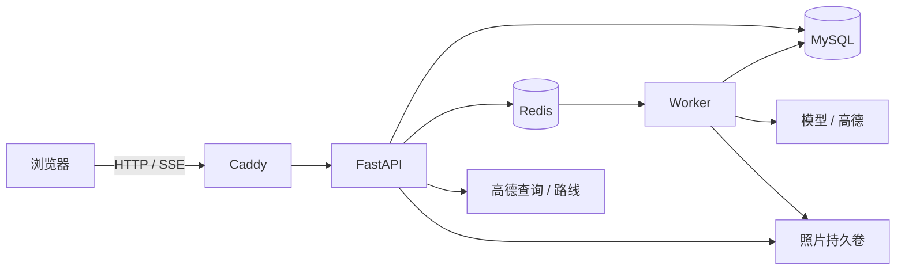

<p align="center">
  
</p>

<p align="center">
  <a href="https://guide.dirtydev.cc">在线体验</a> ·
  <a href="#自己部署">自己部署</a> ·
  <a href="docs/ARCHITECTURE.md">后端设计</a> ·
  <a href="README.en.md">English</a>
</p>

<p align="center">
  
  
  
  
</p>

Tripwright 是一个可自行部署、面向电脑浏览器的旅行规划 Agent。选一座城市，在对话中寻找地点，把想去的地方加入路线，并在地图上比较步行和驾车方案。每次旅行分别保存对话、收藏和路线，下次打开可以继续规划。

[](docs/assets/readme/routes.webp)

## 在线体验

打开 [在线 Demo](https://guide.dirtydev.cc)，选择城市即可开始，无需登录、授权定位或上传照片。也可以直接浏览地图和旅行资料。

公共 Demo 有调用额度，适合短时间体验；请勿上传敏感照片或私人信息。演示站支持注册和登录，邮箱验证与密码找回暂不可用。

## 旅行规划

### 目的地与地点搜索

选择推荐城市或输入目的地，浏览景点、街区和住宿地点。地点卡片提供图片和地址，支持收藏、加入路线和继续向导游提问。

[](docs/assets/readme/home.webp)

### 对话与旅行资料

旅行资料、对话和地图放在同一个工作区。Agent 结合已有地点和路线回答问题，并按需要搜索地点、创建或调整路线。历史消息可以搜索，提问可以编辑、删除或重新发送；编辑后，受影响的旧回答会被标记。

<p align="center">
  
</p>

### 路线编辑

在路线面板搜索和添加地点，调整停留点顺序，或移除地点。切换步行与驾车模式，查看高德返回的线路、距离和预计时长。路线计算失败时，地点列表仍会保留，可重新计算。

### 模型与思考模式

在输入框下方选择模型，通过档位按钮和滑条调整“关闭、轻度、标准、深入”四档思考模式，可用档位随模型能力变化。任务保存发送时的模型与档位，后续切换不会改变正在生成的回答。支持 OpenAI Chat Completions 兼容接口，供应商密钥保存在服务器端，配置方式见 [模型与深度思考](docs/MODELS.md)。

<p align="center">
  
</p>

### 旅行保存与照片识别

可以先以访客身份试用，再将旅行保存到账号。多次旅行分别保存，刷新页面或再次登录后可继续查看。上传景点照片后，确认识别出的地点即可获取讲解。

<p align="center">
  
</p>

## 自己部署

使用 Docker Compose 从源码构建前后端，一台服务器运行 Web、API、Worker、MySQL 和 Redis，Caddy 提供 HTTPS。

需要 Docker Engine 与 Compose v2、解析到服务器的域名、OpenAI Chat Completions 兼容模型接口，以及高德 Web 服务 Key 和 Web 端 JS Key。邮箱验证与密码找回还需配置 SMTP。

先克隆仓库，再进入项目目录：

```bash
git clone https://github.com/DirtyDidsDoneDerCheap2049/AI_Guide.git
cd AI_Guide
```

在仓库根目录执行以下 Linux 命令。已有 `.env` 时直接编辑，不要覆盖：

```bash
cp -n deploy/.env.production.example .env
chmod 600 .env
nano .env
```

填写数据库密码、随机会话密钥、模型与高德配置，设置 `SITE_ADDRESS` 和 `PUBLIC_BASE_URL`。保留 `IMAGE_REGISTRY=local` 即可从源码构建，具体变量见 [部署指南](docs/DEPLOYMENT.md)。

```bash
# 2GB 机器使用小内存配置；分开构建，降低同时编译的内存占用。
docker compose -f docker-compose.yml -f deploy/compose.small.yml config --quiet
docker compose -f docker-compose.yml -f deploy/compose.small.yml pull mysql redis
docker compose -f docker-compose.yml -f deploy/compose.small.yml build api
docker compose -f docker-compose.yml -f deploy/compose.small.yml build web
docker compose -f docker-compose.yml -f deploy/compose.small.yml up -d
docker compose -f docker-compose.yml -f deploy/compose.small.yml ps -a
```

迁移容器 `migrate` 正常完成时显示 `Exited (0)`。API 就绪后，Caddy 自动申请 HTTPS 证书，浏览器打开配置的域名即可。

已在 Ubuntu 24.04、2GB 内存的单机上部署运行。服务器配置与运维步骤见 [部署指南](docs/DEPLOYMENT.md)。

本地开发、fixture 模式和独立测试库配置见 [开发指南](docs/DEMO-STARTUP.md)。

已有部署的更新步骤见 [部署文档](docs/DEPLOYMENT.md#更新)。更新时保留原有配置和数据卷。

## 架构

| 部分 | 技术与职责 |
|---|---|
| 网页 | Vue 3、TypeScript、Vite；城市入口、对话、资料、地图和路线 |
| API | FastAPI、Pydantic；输入校验、归属校验、版本冲突与任务创建 |
| 数据库 | MySQL、SQLAlchemy、Alembic；旅行、消息、路线、运行状态与事件 |
| 后台任务 | Dramatiq Worker；模型调用、步骤推进、租约和超时恢复 |
| 队列与缓存 | Redis；任务投递、短期缓存和部分限流 |
| 页面进度 | SSE；通过持久事件和游标补发断线期间的更新 |
| 外部服务 | OpenAI Chat Completions 兼容接口、高德地点检索与算路、JS 地图安全代理 |
| 部署 | Docker Compose、Caddy、持久化数据卷 |



模型任务由 Worker 执行，旅行状态保存在 MySQL。消息与路线修改使用版本号，重复上传使用幂等键；任务有有限重试、取消、租约与费用预算。模型能执行的路线操作经过结构校验和业务边界检查。

实现细节、失败路径和代码入口见 [架构说明](docs/ARCHITECTURE.md)。

## 功能限制

- 主要适用于电脑浏览器和国内城市规划，地点、图片和路线由高德提供。营业时间、票价和预约规则需向对应场所核实。
- 攻略和 B 站视频目前来自已收录链接与搜索入口，不解析全网攻略正文或视频内容。
- 仅接受服务端白名单内的模型。接入其他供应商时，需确认 Chat Completions 参数、结构化输出与图片能力的兼容性。
- 邮箱验证和密码找回依赖真实 SMTP；`console` 仅用于开发，不投递邮件。
- 当前没有订票、支付、实时导航或独立手机 App。

## 许可证

源码使用 [MIT License](LICENSE)。界面截图中的地图、地点照片和第三方标识保留原权利归属，见 [图片来源说明](docs/assets/readme/README.md)。
